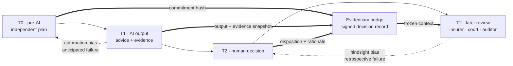

# Defensible Autonomy: Cryptographic Decision Receipts as an Evidentiary Bridge Between Automation Bias and Hindsight Liability

**Status:** working paper.
**Audience:** health-informatics, AI-law, and FAccT readers.
**Terminology note:** PersonaVault calls the person or thing a decision is about the **subject** (`subject_id`, `subject_type`); its consent model maps FHIR `Consent.patient` to `subject_id`. "Patient" is a pack-configurable UI label ("Patient" in the oncology pack, "Subject" in the generic clinical pack), not a schema field. This paper uses *subject* generically and *patient* only when discussing the clinical literature.

---

## Abstract

High-stakes AI assistance creates a temporal asymmetry in human accountability. At decision time, the human reviewer is exposed to *automation bias* (undue deference to a confident recommendation) and to its mirror image, *algorithm aversion* (discarding a useful recommendation after observing an error). At review time — months later, in a malpractice claim, an audit, or a regulatory proceeding — the same decision is evaluated by fact-finders who already know the outcome and are exposed to *hindsight bias*. Legal doctrine offers partial shelter: the respectable-minority / two-schools-of-thought rule protects reasoned practice variation, but only if the reasoning can be shown to have existed at the time. Today's common substrate — an application log plus an electronic record — proves that an output was displayed and a button was pressed; it does not prove what was knowable, what was independently considered, or why a human departed from a recommendation.

We argue that the missing object is an **evidentiary bridge**: a tamper-evident, offline-verifiable record that binds the human's pre-AI commitment, the exact AI output and evidence state, the human's deliberation and disposition of each recommendation, and a versioned amendment chain, all signed at decision time. We present the Cryptographic Decision Receipt (CDR, `cdr.v1`) as a reference implementation of this bridge and analyze, check by check, what it does and does not establish. Our contribution is a framework and a boundary analysis, not an empirical finding of admissibility or improved outcomes: a signature proves integrity of a payload, not clinical correctness, signer identity, execution, completeness, absence of automation bias, or the legal sufficiency of an override. We close with an evaluation agenda: the bridge is falsifiable if commitment gates change recorded behavior without changing reasoning, or if fact-finders' judgments are unchanged by receipt-backed context.

---

## 1. Introduction

The promise of clinical decision support was that AI would reduce error. The observed reality is a double bind. Physicians are asked to use tools they did not select and cannot fully inspect, and are held responsible both for following a flawed recommendation and for ignoring a sound one (Patil et al., 2025; Appel, 2025). In a randomized vignette study across U.S. and German samples, physicians who rejected AI advice aligned with standard care were rated significantly less reasonable than those who accepted it; where the AI recommended *nonstandard* care, accepting and rejecting were rated equivalently reasonable (Tacconelli et al., 2026). The law's own categories are unsettled: the respectable-minority doctrine has historically shielded physicians who follow a respected school of thought, but its protection depends on showing that the approach was adopted in the exercise of judgment — a showing that is evidentiary, not doctrinal (Price et al., 2024; Peters, 2000).

This paper asks a narrower question than "how do we make AI more accurate?" It asks: **what artifact would let a reviewer distinguish an unexplained deviation from a documented judgment, without granting the artifact powers it does not have?**

Three observations motivate the answer.

1. **At decision time, independence is fragile.** Automation bias is a reliable laboratory finding, mediated by workload, task complexity, and time pressure (Goddard et al., 2012; Lyell & Coiera, 2017). Its inverse, algorithm aversion, is equally well documented (Dietvorst et al., 2015; Burton et al., 2020). A record of the *final* decision cannot reveal which failure mode operated.
2. **At review time, the epistemic position is different.** Hindsight bias contaminates every retrospective review: the reviewer knows the outcome and cannot unknow it. Medical documentation case law shows that altered or missing notes — not merely erroneous care — drive adverse outcomes, and that alteration can in some courts reverse the burden of proof (Ghaith et al., 2022).
3. **The law already asks the right question, but the record cannot answer it.** EU AI Act Art. 14(4)(d) requires that oversight persons be enabled to "disregard, override or reverse" a high-risk system's output, and Art. 14(4)(b) requires awareness of automation bias. The regulation specifies a *capacity*; it is silent on *evidence of exercise*. California AB 2575 would have gone further — restricting the "clinician should have overridden it" defense — but was vetoed on 30 September 2026; AB 1979, signed the same day and effective 1 January 2027, instead requires reasonable steps to preserve clinicians' independent judgment (Holland & Knight, 2026). The gap between "may override" and "can prove the override was reasoned" remains.

## 2. Related work

**Human–AI judgment.** Automation bias (Mosier & Skitka, 1996; Goddard et al., 2012) and algorithm aversion (Dietvorst et al., 2015; Burton et al., 2020) are well characterized but usually studied separately from liability. Appel's "negative outcome penalty paradox" (Appel, 2025) is the closest statement of the double bind: physicians risk jury penalties whether they overrule or accept AI. Tacconelli et al. (2026) refine the empirical picture and, importantly, find *equivalence* between accepting and rejecting nonstandard AI advice — a boundary condition this paper relies on. Dai and Singh's analytical model (Dai & Singh, 2025) explains why physicians may avoid AI precisely in high-uncertainty cases where it would be most useful.

**Liability doctrine.** The respectable-minority / two-schools rule is a burden-allocation device: the defendant identifies a second school of thought, and the plaintiff must persuade that the chosen approach was acceptable (Peters, 2000; Price et al., 2024). Its evidentiary demands are poorly specified — a 2026 analysis of the Restatement (Third) of Torts notes that the commentary does not say what "acceptability" consists in when evidence tells against a practice (Nikolic, 2026). Our claim is not that a receipt satisfies this doctrine, but that it supplies the *contemporaneous record* the doctrine presupposes.

**Tamper-evident evidence.** Cryptographically chained audit logs have a long literature (Schneier & Kelsey, 1999; Snodgrass et al., 2004; Yavuz et al., 2011) and a current one (Nitro, CCS 2025; "Agent Flight Recorder," 2026; "Notarized Agents," 2026). The distinguishing feature of the CDR is not the hash chain — that is table stakes — but the *semantic fields* bound at decision time.

**Three evidentiary primitives.** We use three terms throughout, defined here so the argument stands on its own. *Sequence* asks whether the human formed a judgment before the AI's output could shape it; its failure mode is retroactive rationalization. *Provenance* asks what evidence was available, what was considered, and what was omitted; its failure mode is evidentiary incompleteness. *Authority* asks by what right the decision was made and whether a stranger can verify that right; its failure mode is portability collapse. These are orthogonal: a record can establish one and fail the others. Prior work develops this trichotomy in detail (Author, 2026); here it is used only as vocabulary. The boundary that matters for this paper is that *integrity of a recorded sequence is not independence of the underlying cognition* — a commitment gate can be satisfied by a ritual.

## 3. The temporal-asymmetry framework

Define a decision episode with three moments:

- **T₀ — pre-AI:** the reviewer records a plan before the AI output is available. Call the binding of that plan `pre_ai_commitment`.
- **T₁ — AI output:** the system renders a recommendation over a declared evidence universe. Call the frozen state `knowledge_state`, and the rendered output `ai_recommendation` plus its transcript.
- **T₂ — decision and review:** the human decides; later, an auditor, insurer, regulator, or court reviews.

Two failure modes are now symmetric across time:

- **T₀ → T₁ (anticipated bias):** if the human cannot commit before exposure, an apparent "independent judgment" may be post-hoc rationalization of the AI's framing.
- **T₁ → T₂ (retrospective bias):** if the reviewer sees only the final state, the AI's confidence score becomes an anchor and the outcome becomes an explanation.

An evidentiary bridge must bind four claims:

| Claim | Mechanism | What it does **not** establish |
|---|---|---|
| The human had a plan before the AI spoke | hashed, timestamped `pre_ai_commitment`, ordered before `knowledge_state.captured_at` | That the plan was genuinely believed, or formed without other influence |
| The AI said exactly this, over exactly this evidence | hash-bound transcript, `knowledge_state.entries` with content hashes, AI provenance graph | That the AI's factual claims were true |
| The human disposed of recommendations deliberately | `adopted_items`, `human_deliberation.rationale` / `dissent`, divergence fields | That the deliberation actually occurred as recorded; that it was read |
| The record was not rewritten later | Ed25519 signature over a canonical payload, append-only version chain | That the originating system was secure; that all relevant evidence was present |

*Figure 1. The two temporal failures and the bridge. Solid arrows are the decision sequence; dotted arrows are the biases the bridge is designed to make visible. The bridge does not correct either bias — it preserves the record against which review can be checked.*

The framework's central normative claim is that these mechanisms change the **standard of review**, not the **standard of care**. They make review contemporaneous in structure even when it occurs in retrospect; they do not make the underlying decision correct.

## 4. Reference implementation: the `cdr.v1` receipt

PersonaVault emits a JSON receipt at `cdr.v1`. Its core is a `cdo.v1` payload canonicalized as sorted-keys-compact (an RFC 8785 subset) and signed with Ed25519 by the chair's key — the signature is over the raw 32 bytes of the payload hash, not over a string. The offline verifier defines 31 distinct failure checks; a frozen verification fixture prints 16 pass-labels, covering schema, payload and snapshot hashes, knowledge-state entries, provenance completeness, consent basis, attestation hash and signature, system receipt signature, transcript hash and binding, pre-AI commitment, record hash, version chain, attestation timestamp, and AI provenance graph. Optional checks (audio manifest, frozen DQI, execution evidence, outcome receipt, mandate) run only when the corresponding artifact is bound. Integrity failures exit non-zero; adequacy and completeness findings are advisory by design: a lexical contradiction finding or a missing completeness attestation is reported to the reader but cannot change the integrity verdict.

Of particular relevance to override defenses:

- **`pre_ai_commitment` / `pre_ai_assessment`** bind a plan hash and (in current signing paths) an inspectable structured plan, with `committed_at < knowledge_state.captured_at`. The sign endpoint refuses a commitment that asserts a plan hash while withholding an inspectable plan; legacy and text-only plans are labelled rather than rejected.
- **`knowledge_state`** records the evidence universe with `available_count`, `retrieved_count`, and per-entry content hashes; a completeness attestation binds the declared universe at signing.
- **`human_decision.content.adopted_items`** records which AI proposal items were adopted, edited, rejected, or deferred, with `ai_proposal_seq` references; signing requires that each adopted item cite evidence and that the sealed AI content be inspectable.
- **Divergence binding.** When the chair submits a draft, the server reads the most recent AI proposal message, extracts a pilot-default set of structured fields (`regimen_name`, `drug_class`, `intent`), and compares each with the corresponding field of the authored decision. A `divergence_from_ai` block is written naming each divergent field, its AI value, its human value, and any chair rationale the draft supplied for that field. The comparison is deterministic field equality, not clinical semantics, and per-field rationale is preserved rather than required: the pack may opt into refusing an unattested divergence, but the clinical pack does not currently do so.
- **Presentation attestation.** At render time the system signs a `presentation_state` recording what was shown, derives an independence class from the recorded sequence, and fails closed if the state cannot be produced. It establishes *exposure*, not that the item was read, understood, or believed.
- **Evidence contradiction detection.** A pilot detector scans AI prose for negated genetic-alteration phrases (for example, "no significant mutations"), then searches the case's source-document episodes for affirmative claims (deletion, mutation, VAF, Tier I). On a match it writes an `evidence_contradiction` block with the AI claim, a source excerpt, and a document/episode reference. This is a narrow lexical heuristic: the citation check verifies that sources exist, not that the AI's claims are true, and the flag is written into the record but not consumed by any downstream check.
- **`dqi.v1` / `dqi.v2`** are decision-quality indices computed from the receipt alone. `dqi.v2` is advisory and never part of integrity checks — and, at the time of writing, is not yet wired into production signing, which freezes `dqi.v1`. `pre_commitment_integrity` is reported but excluded from the `dqi.v1` weighted score precisely because sequence integrity is a precondition, not a component of quality.

These fields implement the four defenses often claimed for such a system, but with narrow scope: freezable context, pre-AI ordering, reasons bound to specific recommendations, and preservation of the AI's own defective words. The fourth is a *preservation* mechanism more reliably than a *detection* mechanism.

## 5. Two worked examples, with their limits

### Exhibit A — defect preservation (the frozen challenge kit)

The shipped verification kit includes a signed `cdr.v1` receipt (`exhibits/exhibit-a-kit-valid.json`, with its tampered counterpart) whose source document identifies an *EGFR exon 19 deletion (VAF 42%)* while the AI's prose asserts "no significant genetic mutations or alterations requiring specific targeted therapies" at 0.9 confidence. The receipt's adopted item is "Recommend targeted therapy as the primary treatment option"; the operative regimen is carboplatin. `session_duration_seconds` is 3.9; `chair_override_rate` is 0.0 and `dissent` is empty.

Three cautions govern this exhibit. First, it is a **fixture** frozen for independent verification, not a clinical case series; its pre-AI assessment is a harness test plan. Second, the human **adopted** the AI recommendation — the inconsistency is between the adopted recommendation and the operative order, not an override of the AI. Third, the divergence and contradiction blocks described in §4 were added to the signing path after this kit was frozen, so the fixture does not contain them. Exhibit A demonstrates only that the receipt preserves the AI's exact defective words and an internal contradiction. A paper must not present it as evidence of a defensible override.

### Exhibit B — a reasoned override, signed end to end

To address the gap in Exhibit A, we generated a second receipt through the current signing path (`exhibits/exhibit-b-override.cdr.json`). It is a **synthetic reference scenario**, not a patient: a 67-year-old subject with stage IIIA lung adenocarcinoma whose referral reports an EGFR exon 19 deletion at VAF 42% and PD-L1 TPS 65%. The AI proposed concurrent chemoradiation followed by durvalumab (immunotherapy, confidence 0.9) and asserted that no significant actionable mutation existed. The chair rejected that item, chose an EGFR-directed regimen, and bound:

- a `divergence_from_ai` block naming `regimen_name` (durvalumab → EGFR-directed therapy) and `drug_class` (immunotherapy → targeted), each with a field-specific rationale;
- an `evidence_contradiction` block pairing the AI's negation with the pathology excerpt and its document/episode reference;
- a recorded `dissent` with grounds, dissenter, and timestamp;
- an alternative considered and rejected, with the reason tied to the documented mutation.

The offline verifier reports `DECISION INTEGRITY: VALID` with seventeen pass-labels and exit code 0, including `Pre-AI commitment`: the seeded plan hash is recomputed from the assessment and the recorded commit time precedes the evidence snapshot. The exhibit therefore exercises all three primitives at once — sequence (commitment before AI output), provenance (hash-bound evidence and AI prose), and authority (consent basis and enrolled chair key) — while binding the override rationale to the AI's exact advice. It does **not** demonstrate clinical correctness, and two limits remain visible: the advisory completeness review reports no terminal marker and no bound completeness attestation, and the scenario is synthetic. A real override case under the full signing gates remains future work; Exhibit B establishes the mechanism, not efficacy.

```mermaid
flowchart LR
    P["T0 · chair plan<br/>plan_hash + committed_at"] -->|"Pre-AI commitment ✓"| A["T1 · AI output<br/>0.9 confidence · 'no significant mutations'"]
    A -->|"Provenance ✓"| E["Source: EGFR exon 19 deletion<br/>VAF 42% · PD-L1 65%"]
    E -->|"Evidence contradiction ✓"| D["T2 · chair decision<br/>reject AI item · EGFR-directed regimen"]
    D -->|"Divergence + dissent + rationale"| R["Signed CDR<br/>Ed25519 · 17 verifier pass-labels"]
    R --> V["Offline third-party verification"]
```

*Figure 2. Exhibit B's end-to-end chain. Each label corresponds to a named verifier check; advisory completeness findings are reported separately and never alter the integrity verdict.*

## 6. What the bridge cannot do

We state the boundaries before a reviewer finds them:

1. **Clinical correctness.** A signature proves a payload did not change; it does not prove the decision was right.
2. **Signer identity.** The receipt names a key; key enrollment and revocation are a separate trust question.
3. **Execution.** The receipt proves *attested*, not *executed*. A second verifier for execution evidence is not implemented.
4. **Completeness.** Completeness is attested relative to a *declared* universe; it is not proof that the universe was complete.
5. **Automation-bias prevention.** A divergence field records an outcome; it does not produce critical scrutiny. Presentation attestation proves exposure, not attention. Prevention is a workflow and training question.
6. **Court admissibility.** No court-admissibility package is built or validated. "Evidentiary bridge" is a design metaphor and a research hypothesis, not a legal conclusion.
7. **Override justification as a first-class proof.** Per-decision structured override reason codes are not yet a required field; the current divergence detector is narrow and opt-in.

### 6.1 Workflow cost and ritualization at T₀

Requiring a clinician to author a structured plan before the AI speaks adds friction at the point of care. A reviewer in clinical informatics should expect the obvious objection: busy clinicians will enter boilerplate to unlock the tool, or bypass the tool altogether, turning T₀ into a checkbox rather than independent cognition. We do not claim that the gate prevents this. The design response is to keep the commitment lightweight — selecting a working intent or differential from a short structured list, with free text optional, in seconds rather than minutes — so the cost of an honest commitment is lower than the cost of bypassing the tool. What is bound is whatever the clinician actually entered, including its shallowness. Whether this succeeds is an empirical question, not a design assertion: E1 below tests explicitly whether commitment gates change recorded behavior without changing reasoning. If they do, the sequence layer documents compliance theater and should be reported as a limitation rather than a safeguard.

### 6.2 Discovery exposure: an honest mirror, not a shield

There is a double edge to freezing internal dissent and unreconciled contradictions. A record that preserves "the AI claimed no actionable mutation, the source reported one, and the chair proceeded anyway" can be subpoenaed in discovery as evidence that the institution knew of a conflict and continued. This is not a defect to be hidden; it follows from the paper's own premise that the receipt is an honest mirror of the decision moment. The CDR protects *justified* overrides by preserving their grounds, and it exposes *careless* ones by preserving the contradiction alongside the decision. The resulting institutional incentive is to resolve discrepancies before signing rather than to document around them. No litigation privilege, admissibility, or immunity is claimed: the artifact is a record like any other, and whether it is discoverable or admissible is a question of jurisdiction and procedure, not of cryptography.

## 7. Evaluation agenda

The framework is falsifiable. We propose four experiments:

- **E1 (sequence and ritualization):** Do commitment gates change recorded behavior without changing underlying reasoning? If recorded commitments become boilerplate entered to unlock the AI, the sequence layer documents compliance theater rather than independent judgment, and the framework's first premise fails for that deployment.
- **E2 (fact-finder):** In vignette experiments varying receipt-backed context (pre-AI plan, AI defect preservation, dissent) against standard logs, do lay jurors and medical experts change their reasonableness ratings of a rejecting physician? The Tacconelli et al. (2026) design provides the instrument.
- **E3 (behavior):** Does decision observability change decisions? A receipt that is never inspected by the reviewer has no epistemic effect.
- **E4 (measurement):** Is the DQI stable under replay and correlated with independently assessed decision quality? Its authors explicitly disclaim current validation.

Until E1–E4 are run, the appropriate claim is: *the CDR makes certain facts about a decision inspectable and tamper-evident in a form a third party can check offline*. The stronger claim — *it protects humans who override AI* — is a design goal.

## 8. Conclusion

Making AI safer cannot be solved solely by making models more accurate. High-stakes oversight also needs an evidentiary layer that preserves what was knowable at the moment of decision and what the human did with the machine's advice. The CDR is one implementation of such a layer. Its value, if any, lies not in a longer hash chain but in the semantic commitments it freezes — and in the honesty with which it states which of those commitments are proofs and which are only records.

---

## References

- Appel, J. M. (2025). Artificial intelligence in medicine and the negative outcome penalty paradox. *Journal of Medical Ethics*, 51(1), 34–39. doi:10.1136/jme-2023-109848.
- Burton, J. W., Stein, M.-K., & Jensen, T. B. (2020). A systematic review of algorithm aversion in augmented decision making. *Journal of Behavioral Decision Making*, 33(2), 220–239. doi:10.1002/bdm.2155.
- Dai, T., & Singh, S. (2025). Artificial intelligence on call: The physician's decision of whether to use AI in clinical practice. *Journal of Marketing Research*, 62(5). doi:10.1177/00222437251332898.
- Dietvorst, B. J., Simmons, J. P., & Massey, C. (2015). Algorithm aversion: People erroneously avoid algorithms after seeing them err. *J. Exp. Psychol. Gen.*, 144(1), 114–126. doi:10.1037/xge0000033.
- Ghaith, S., Moore, G. P., Colbenson, K. M., & Lindor, R. A. (2022). Charting practices to protect against malpractice: Case reviews and learning points. *West J Emerg Med*, 23(3), 412–417. doi:10.5811/westjem.2022.1.53894. *(10–20% figure is from its introduction, citing Cohn 1997; the study itself is qualitative.)*
- Goddard, K., Roudsari, A., & Wyatt, J. C. (2012). Automation bias: A systematic review. *JAMIA*, 19(1), 121–127.
- Holland & Knight. (2026, October 15). Keeping humans in the loop: California sets new ground rules for AI in healthcare. *(AB 2575 vetoed 30 Sep 2026; AB 1979 signed, effective 1 Jan 2027.)*
- Author. (2026). *Beyond AI Audit Trails: The Three Foundations of Verifiable Decision Evidence* (v3.3). Anonymized for review.
- Lyell, D., & Coiera, E. (2017). Automation bias and verification complexity: A systematic review. *JAMIA*, 24(2), 423–431.
- Patil, S. V., Myers, C. G., & Lu-Myers, Y. (2025). Calibrating AI reliance—A physician's superhuman dilemma. *JAMA Health Forum*, 6(3), e250106. doi:10.1001/jamahealthforum.2025.0106.
- Nikolic, B. (2026). Regarded as competent: Medical knowledge and professional acceptance in the Restatement (Third) of Torts. *J Eval Clin Pract*, 32(8), e70751. doi:10.1111/jep.70751.
- Peters, P. G. (2000). The quiet demise of deference to custom: Malpractice law at the millennium. *57 Wash. & Lee L. Rev.* 163.
- Price, W. N., et al. (2024). Liability for use of artificial intelligence in medicine. In *Research Handbook on Health, AI and the Law*. NCBI Bookshelf NBK613216.
- Schneier, B., & Kelsey, J. (1999). Secure audit logs to support computer forensics. *ACM TISSEC*.
- Snodgrass, R. T., Yao, S. S., & Collberg, C. (2004). Tamper detection in audit logs. *VLDB*.
- Tacconelli, A., Merane, J., Nielsen, A., Tobia, K., Hackanson, B., & Stremitzer, A. (2026). How following medical artificial intelligence advice can mitigate malpractice liability: Cross-national insights from a randomized trial. *Journal of Nuclear Medicine*, 67(9), 1474–1480. doi:10.2967/jnumed.126.272292. PMID 42242875.
- Yavuz, A. A., Ning, P., & Reiter, M. K. (2011). Efficient, compromise resilient and append-only cryptographic schemes for secure audit logging. *NCSU TR*.
- EU AI Act, Regulation (EU) 2024/1689, Art. 14 (consolidated 27 Jul 2026).

**Adjacent contemporary systems.** *Nitro: Rethinking Tamper-Evident Logging* (CCS 2025, doi:10.1145/3719027.3765024), *Agent Flight Recorder* (arXiv:2609.01931, 2026), and *Notarized Agents* (arXiv:2606.04193, 2026) each provide integrity, ordering, and external verifiability; none claims the decision-time semantic commitment structure analyzed here.

