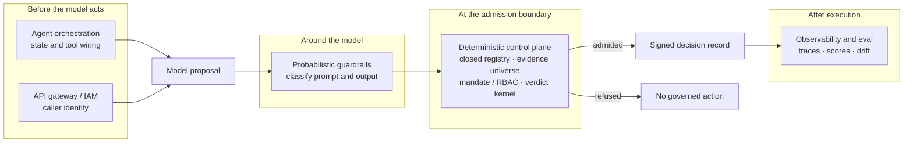
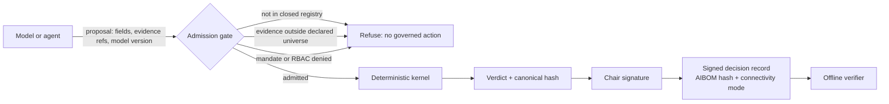

# Models Propose, the Control Plane Disposes

## A deterministic admission layer for regulated AI

---

### Status

This is a **perspective whitepaper**, not a peer-reviewed article, certification,
or product datasheet. Category descriptions of other tools are based on public
documentation, not comparative testing. No claim of superiority, certification,
model invariance or clinical correctness is made.

**Date:** 2026-11-27

---

### Abstract

Regulated organisations are deploying language models into workflows that touch
clinical decisions, financial commitments and subject records. Most available
governance takes one of two forms: a probabilistic guardrail that asks one model
to inspect another, or an observability layer that records what happened after
the model ran. Both have a place. Neither establishes, before execution, that a
model's proposal matches an admitted evidence universe and an authorized actor.

This paper describes a different layer: a deterministic control plane between
probabilistic models and systems of record. The model proposes fields, evidence
and recommendations. The control plane admits or refuses them against a closed
registry, a declared evidence universe, a deterministic verdict kernel and a
signed mandate. What survives is signed into a portable record that a third
party can check offline.

The boundary is precise. The layer proves bytes, attribution, admission
outcomes and version binding. It does not prove clinical truth, causal
improvement, absence of network egress, model-swap invariance or regulatory
compliance. Publishing that boundary is part of the design.

---

### 1. The gap between capability and governability

Four categories dominate the current market conversation.

| Category | What it does | Category limitation |
|---|---|---|
| Probabilistic guardrails — e.g. NeMo Guardrails, Llama Guard, Lakera | Classifies prompts and outputs for toxicity, PII or jailbreaks using models or pattern rules | Still probabilistic: false positives, bypasses, and no cryptographic proof of which authority allowed an action |
| Observability and eval — e.g. LangSmith, Arize, WhyLabs | Logs traces, scores outputs, monitors drift and latency after execution | Reactive: it explains what happened; it does not refuse an unadmitted proposal before commitment |
| Agent orchestration — e.g. LangGraph, CrewAI, AutoGen | Chains prompts, state and tools so agents can do more | Optimizes capability; RBAC, evidence admission and non-repudiation are left to the integrator |
| API gateways and IAM — e.g. Kong, Okta | Authenticates callers and controls network-level access | Knows who called an endpoint, not whether an extracted field matches the admitted evidence universe |

These are simplified category descriptions, not findings about any named
product. The common gap is the same: none of these layers is, by design, a
**pre-execution admission boundary for probabilistic payloads**.

That boundary is where a governed decision becomes a record rather than a log.

The same gap is easier to see on an execution timeline. Each category sits at a
different point; only one of them is a pre-execution admission boundary for the
proposal itself.

This is a category map, not a benchmark result. It shows where each class of
tool acts; it makes no claim about any named product.

---

### 2. Architecture: the control plane

The governing rule is one sentence:

> **Models propose; the control plane admits, authorizes, signs and records.**

The refusal paths are the point: an unadmitted proposal does not become a
governed action or a signed record. The kernel establishes contract conformance,
not truth.

It has five parts.

**Closed operation registry.** Chat and agent paths dispatch only from a fixed
set of operations. An unknown intent fires nothing. There is no arbitrary tool
calling and no model-selected endpoint.

**Declared evidence universe.** A proposal may cite only evidence admitted for
the case and kind. Evidence hashes are recorded, not reinterpreted. A field
without an admitted excerpt cannot reach the decision kernel.

**Deterministic admission and verdict kernel.** Schema conformance, evidence
binding and governance checks produce a verdict from admitted fields. The
kernel is deterministic and re-runnable across processes; its output is
canonical-hashed. Contract conformance is not truth — the kernel proves that a
proposal met the contract.

**Mandates and role-bound authority.** A signed mandate records principal,
capability, purpose, scope, constraints and validity. RBAC governs access to an
answer; the mandate governs the authority under which an act is recorded. A
stored `granted_by` string does not prove real-world identity.

**Signed, portable record.** The chair signs canonical decision-record bytes
with Ed25519. The record binds the evidence hashes, the session AIBOM, the
model composition and the declared connectivity mode. An append-only event
ledger records the governance acts. Offline verifiers check bytes and
signatures without an account or vendor portal.

---

### 3. Proof surface

What a buyer can inspect:

- **Receipts** — canonical hash and Ed25519 signature over the exact signed
  bytes; verified offline by `tools/verify_cdr.py` and its browser parity copy.
- **Frozen challenge kit** — three files that verify as expected, including a
  one-character tamper that fails a named check.
- **AIBOM** — session-scoped model composition, inference parameters and pack
  hash, bound by `aibom_hash` into the signed record.
- **Model-change notice** — an advisory in-app notice when the active model
  configuration changes, with an explicit limit: a silent provider-side swap
  behind an unchanged checkpoint id cannot be detected.
- **Connectivity declaration** — a versioned block in the signed record naming
  `air_gapped` or `hybrid` at draft time, plus application-level refusal of
  outbound paths in air-gapped mode. It does not prove network egress was
  absent.
- **Control-effectiveness brief** — SQL aggregates with denominators over the
  recorded controls, with absent fields shown as null or unrecorded.

These artifacts make the system's recorded state checkable. They are not an
audit opinion.

---

### 4. Claim boundary

| The layer proves | The layer does not prove |
|---|---|
| Exact bytes were signed by the enrolled key | That the decision was clinically or financially correct |
| Admitted fields passed the deterministic kernel | That the underlying evidence was true or externally complete |
| A model composition and pack version were recorded | That the model behaves identically after a swap |
| A connectivity mode was declared at signing time | That no data left the host |
| A contestation or override was recorded | That the challenge was correct or the outcome better |
| Verifiers recompute hashes and signature offline | That an external auditor accredited the system |

"Externally complete" is deliberate. A signed completeness attestation covers
the **declared** evidence universe: the document ids the record says it
expected. The offline verifier can check fail-closed missing references inside
that universe. It cannot know whether a clinician forgot to upload a scan, or
whether a real-world source existed outside the declaration.

This boundary is not a disclaimer added at the end. It is the design
constraint. A governance layer that claims more than its artifacts prove is a
marketing layer.

---

### 5. Negative evidence

A proof-oriented system publishes its failures.

- Kernel determinism passes across two processes.
- Out-of-sample extractor validation **failed**; criteria were not relaxed.
- Model-swap invariance is unproven; a later result passed only at the boundary
  in-sample.
- The controlled reinforcement evaluation is preregistered but **unrun** — no
  independent outcome data exists.
- Two restore drills failed on orphaned foreign-key data; after cleanup a third
  restored 119 tables to a scratch database. That is one exercised restore,
  not a cadence.
- No external audit opinion, accreditation, ethics approval or certification
  exists.

These facts are included because a system that reports only successes is not a
proof system.

---

### 6. The category, in one sentence

> A deterministic control plane between probabilistic AI models and systems of
> record — turning unverified model proposals into admitted, attributable and
> cryptographically signed decision records.

The phrase "cryptographically signed decision records" is deliberate. We sign
records, not arbitrary actions or clinical conclusions.

Useful buyer questions:

1. Which model proposal was admitted for this decision, and under which evidence hashes?
2. Which mandate authorized the act, and who signed the record?
3. Can an independent party verify the record without our application?
4. What was declared about connectivity and model version at signing time?
5. Which of your controls have actually been tested, and when?

---

### 7. Conclusion

Guardrails, observability, orchestration and IAM each solve a real problem. The
admission boundary is a different problem: making a probabilistic proposal
governable before it reaches a system of record. That boundary is small,
deterministic and checkable. It is not the whole of AI governance, and it does
not make an organisation compliant. It is the part we build.

---

**Supporting technical artifacts available during diligence:** Core Invariant
Specification, Claim Matrix, Control Effectiveness Brief, Regulatory Position
(IG eHealth), IBM Digital Sovereignty Index mapping, AI Sovereignty in Policy
Discourse mapping, and External Audit Scope.

**No certification, external assurance, clinical validation or competitive
superiority is claimed by this document.**
